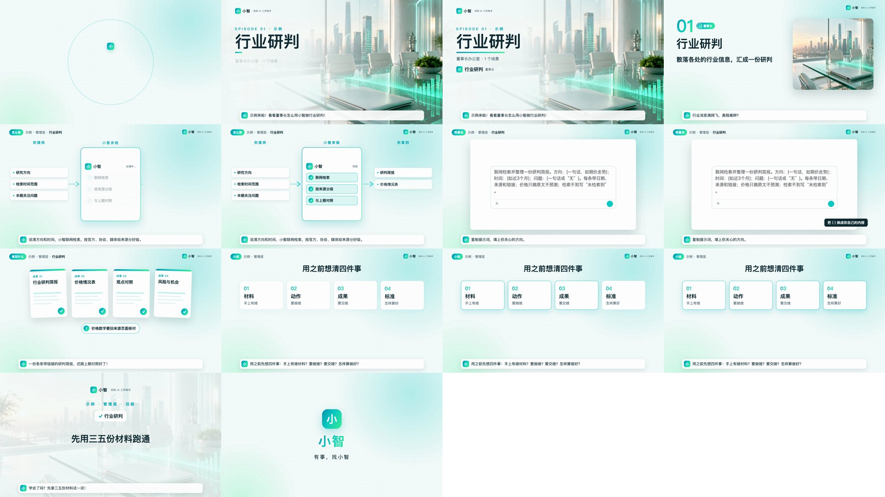

# explainer-video

用代码批量做讲解、培训、场景教程视频的 Claude Code skill。

**内容写成 JSON，画面交给模板，声音交给 API，质量交给脚本检查。** 不需要剪辑软件，改一句话重渲一集只要两三分钟。



- **7 种镜头**：封面、小节开场、三栏流程动画、录屏推近、成果卡片、要点宫格、收尾回顾。
- **声画同步**：每个镜头的长度跟着配音走，切点卡在音乐节拍上；有人声时音乐自动压低。
- **多家接口**：配音、配图、配乐可接 OpenRouter、任何 OpenAI 兼容服务（OpenAI、腾讯云、自建网关等）、阿里云百炼、火山引擎（方舟 / 豆包语音）。
- **品牌一处改**：名称、配色、logo 都在 `brand.json`，片头片尾由代码生成，不依赖视频素材。
- **出片前自动质检**：禁用色扫帧、响度检测、抽帧拼图，再统一响度到 -16 LUFS。

## 安装

```bash
git clone https://github.com/ENCHIGO/explainer-video ~/.claude/skills/explainer-video
```

- **依赖**：Node 18+、ffmpeg、Python 3，再执行 `pip install numpy pillow`。
- **使用**：在 Claude Code 里说「把这份文档做成讲解视频」，就会自动调用。也可以照着 [SKILL.md](SKILL.md) 手动跑。

## 五分钟跑通示例

```bash
cd ~/.claude/skills/explainer-video
cp .env.example .env            # 至少填一家的密钥
cp -R template ~/my-video && (cd ~/my-video && npm install)
python3 scripts/tts.py example/script.json ~/my-video-vo
python3 scripts/music.py "Upbeat bright corporate pop, 122 BPM, claps, marimba, no vocals, steady groove" ~/music.mp3   # 也可以用自己的音乐
python3 scripts/plan.py example/script.json ~/my-video-vo ~/my-video --bpm 122 --music ~/music.mp3
cd ~/my-video && npx remotion render Episode out/episode.mp4 --crf=14
```

## 接入方式

| 接入方式 | 环境变量 | 配音 | 配图 | 配乐 | 实测 |
|---|---|---|---|---|---|
| OpenRouter | `OPENROUTER_API_KEY` | ✅ | ✅ | ✅ | ✅ 三项都实测出片 |
| OpenAI 兼容 | `OPENAI_API_KEY` + `OPENAI_BASE_URL` | ✅ | ✅ | ✅* | ✅ 配音已实测（以 OpenRouter 作网关） |
| 阿里云百炼 | `DASHSCOPE_API_KEY` | ✅ Qwen-TTS | ✅ Qwen-Image | — | ⚠️ 按官方接口格式实现，未实测 |
| 火山方舟 | `ARK_API_KEY` | — | ✅ Seedream | — | ⚠️ 请求已到达服务端，测试账号未开通模型，没能出图 |
| 火山豆包语音 | `VOLC_TTS_APPID` + `VOLC_TTS_TOKEN` | ✅ | — | — | ⚠️ 按官方接口格式实现，未实测 |

\* 需要网关本身支持 Lyria 这类音频模型。不想生成配乐的话，任何免版权音乐都可以直接传给 `plan.py --music`。

用某一家时，选择方式、换模型和换音色的变量，都写在 [`scripts/providers.py`](scripts/providers.py) 顶部。欢迎提 PR 补充更多接入方式，或报告接口变化。

## 目录

```
SKILL.md              给 Claude 看的完整流程（也适合人读）
scripts/              providers / tts / image / music / plan / qa / finalize
template/             Remotion 工程（Episode.tsx + brand.json）
example/              示例分镜 + 素材（含通用界面截图生成脚本）
reference/            踩坑记录、业内技术栈与教程链接
```

## 许可

- **代码**：MIT。
- **Remotion**：Remotion 本身对一定规模以上的公司要求购买[商业授权](https://www.remotion.dev/license)，商用前请先确认。
- **素材**：示例图片由 AI 生成。用 AI 配音、配乐、配图时，请遵守各服务商的使用条款。

---

**English (short):** A Claude Code skill for producing narrated explainer/training videos from a JSON storyboard. It uses Remotion for rendering, and pluggable TTS/image/music providers (OpenRouter, any OpenAI-compatible endpoint, Alibaba DashScope, Volcengine). Cuts are beat-synced and the music ducks under the voice. QA scripts are included. See SKILL.md (Chinese).
